# Mini ERP

## Setup

ใช้ Windows, .NET 10 SDK, MySQL Server 8.0.16 ขึ้นไป, Node.js 20.19.x/22.12+/24+ และ npm

### Backend

ก่อนเริ่ม ให้เปิด MySQL Server หากใช้ XAMPP ให้เปิด XAMPP Control Panel แล้วกด `Start` ที่แถว `MySQL` (ไม่ต้องเปิด Apache) จากนั้นเปิด MySQL Workbench เชื่อมต่อ Server โดยใช้พอร์ตเดียวกับที่จะกรอกในไฟล์ตั้งค่า:

1. ที่แถบ `SCHEMAS` คลิกขวา แล้วเลือก `Create Schema...`
2. ช่อง `Name` ใส่ `mini_erp` แล้วกด `Apply` → `Apply` → `Finish`
3. สร้างเป็นฐานข้อมูลเปล่า ไม่ต้องสร้างตารางเอง

เตรียม **ชื่อผู้ใช้และรหัสผ่านของ MySQL Server** ที่มีสิทธิ์สร้าง/แก้ไขตารางใน `mini_erp` ไว้ใช้ตอนตั้งค่า ชื่อนี้ไม่ใช่บัญชีทดสอบของเว็บ

ทำตามลำดับ **ตั้งค่าฐานข้อมูล → บันทึกการเชื่อมต่อ → สร้างตารางและเปิด API**:

#### ส่วนที่ 1: ตั้งค่าการเชื่อมต่อ MySQL

**ใช้ไฟล์ตั้งค่า:** ดับเบิลคลิก `setup-db-connection.bat` ที่โฟลเดอร์หลักของโปรเจกต์ ครั้งแรกสคริปต์จะสร้างและเปิด `backend\db-connection.json` ใน Notepad ให้กรอกค่า:

```json
{
  "server": "127.0.0.1",
  "port": 3306,
  "database": "mini_erp",
  "userId": "root",
  "password": "ใส่รหัสผ่าน MySQL ที่นี่"
}
```

ใส่ชื่อผู้ใช้/รหัสผ่านที่ใช้เชื่อมต่อ MySQL Workbench; ถ้าไม่มีรหัสผ่านให้ใช้ `"password": ""` จากนั้นบันทึกและปิด Notepad สคริปต์จะอ่านไฟล์นี้และเก็บค่าการเชื่อมต่อกับ JWT key ไว้ใน User Secrets แล้วจบการทำงาน **ขั้นตอนนี้ยังไม่สร้างตารางหรือเปิด API**

**ถ้าไฟล์ตั้งค่ามีอยู่แล้ว:** เปิด `backend\db-connection.json` ใน VS Code/Notepad แล้วตรวจหรือแก้ค่า จากนั้นดับเบิลคลิก `setup-db-connection.bat` เพื่อบันทึกค่าไว้ใน User Secrets โดยไม่ต้องพิมพ์รหัสผ่านใน Terminal ไฟล์นี้ถูก ignore โดย Git เพื่อไม่ส่งรหัสผ่านขึ้น repository

#### ส่วนที่ 2: สร้างตาราง/ข้อมูลตัวอย่างและเปิด Backend

**รัน Backend:** หลัง `setup-db-connection.bat` ทำงานสำเร็จแล้ว ให้ดับเบิลคลิก `setup-backend.bat` ที่โฟลเดอร์หลักของโปรเจกต์แยกอีกครั้ง ไฟล์นี้ไม่ถามรหัสผ่าน แต่ใช้ค่าที่บันทึกไว้เพื่อ restore dependencies, รัน EF migration สร้างตาราง `products`, `users`, `product_logs`, `__EFMigrationsHistory` และข้อมูลตัวอย่างใน `mini_erp` จากนั้นเปิด API ให้เปิดหน้าต่างนี้ค้างไว้ขณะใช้งาน; ปิดหน้าต่างเพื่อหยุด API

ถ้าต้องการรันผ่าน PowerShell ให้เปิดที่โฟลเดอร์หลักของโปรเจกต์แล้วใช้:

```powershell
.\setup-db-connection.bat
.\setup-backend.bat
```

คำสั่งแรกใช้บันทึกค่าการเชื่อมต่อ (ครั้งแรกจะเปิด Notepad ให้กรอกไฟล์แล้วบันทึก/ปิด) ส่วนคำสั่งที่สองใช้สร้างตารางและเปิด API ซึ่งเปิดที่ `http://localhost:5285`; Swagger อยู่ที่ `http://localhost:5285/swagger`

**ป้อนคำสั่งเอง:** ใช้ PowerShell ที่โฟลเดอร์ `backend` หลังตั้งค่าการเชื่อมต่อในส่วนที่ 1 แล้วรัน:

```powershell
dotnet tool restore
dotnet restore
dotnet tool run dotnet-ef -- database update
dotnet run --launch-profile http
```

**กรณีขึ้น `Table 'products' already exists`:** มีตาราง `products` อยู่ก่อน แต่ Migration ยังสร้าง schema ที่ต้องการไม่สำเร็จ อาจเป็นตารางเก่าหรือ Migration ที่หยุดค้าง อย่าลบฐานข้อมูลหากมีข้อมูลที่ต้องเก็บไว้ ให้สำรองและตรวจฐานข้อมูลก่อน หากเป็นฐานข้อมูลทดลองที่ลบได้ ให้ลบ schema `mini_erp` ใน MySQL Workbench แล้วสร้าง schema เปล่าชื่อเดิม จากนั้นรัน `setup-backend.bat` อีกครั้ง Migration จะสร้างตารางให้เอง ไม่ต้องสร้างตารางด้วยมือ

#### เปิดใช้งานครั้งถัดไป (ไม่ต้อง Setup ซ้ำ)

หลังทำขั้นตอนตั้งค่าฐานข้อมูลและสร้างตารางครั้งแรกแล้ว การใช้งานปกติ **ไม่ต้องรัน `setup-db-connection.bat`, `setup-backend.bat`, สร้าง schema หรือ `npm install` ซ้ำ**

1. เปิด MySQL Server (ถ้าใช้ XAMPP ให้กด `Start` ที่ `MySQL`)
2. เปิด PowerShell ที่โฟลเดอร์ `backend` แล้วรัน `dotnet run --launch-profile http` เพื่อเปิด API ที่ `http://localhost:5285` ทิ้งหน้าต่างนี้ไว้
3. ถ้าจะใช้ Web ให้เปิด PowerShell อีกหน้าต่างที่โฟลเดอร์ `web` แล้วรัน `npm start` เข้าเว็บที่ `http://localhost:4200`
4. ถ้าจะใช้ Windows Forms ให้เปิด PowerShell อีกหน้าต่างที่โฟลเดอร์หลัก แล้วรัน `dotnet run --project app\MiniErp.App.csproj`

ปิดหน้าต่างของแต่ละโปรแกรมเพื่อหยุดการทำงาน ใช้ `setup-backend.bat` อีกครั้งเฉพาะเมื่อมี Migration ใหม่ที่ต้องนำไปใช้ และใช้ `setup-db-connection.bat` อีกครั้งเมื่อเปลี่ยนการตั้งค่าฐานข้อมูล

### Web Application

**วิธีที่ 1: ใช้ไฟล์ BAT**

หลังเปิด Backend แล้ว ให้ดับเบิลคลิก `setup-web.bat` ที่โฟลเดอร์หลักของโปรเจกต์ สคริปต์จะติดตั้ง npm dependencies แล้วเปิด Angular development server; เปิดหน้าต่างนี้ค้างไว้และเข้าเว็บที่ `http://localhost:4200`

**วิธีที่ 2: ป้อนคำสั่งเอง**

หรือเปิด PowerShell อีกหน้าต่างที่โฟลเดอร์หลักของโปรเจกต์ แล้วรัน:

```powershell
cd web
npm install
npm start
```

### Windows Forms Desktop App

เมื่อ Backend เปิดอยู่ ให้เปิด PowerShell ที่โฟลเดอร์หลักของโปรเจกต์ในอีกหน้าต่าง แล้วรัน:

```powershell
dotnet run --project app\MiniErp.App.csproj
```

ถ้า Backend ไม่ได้เปิดที่ `http://localhost:5285` ให้แก้ `Api:BaseUrl` ใน `app\appsettings.json`

## เวอร์ชันเครื่องมือ

เวอร์ชันที่ใช้ตรวจสอบในสภาพแวดล้อมพัฒนา:

| เครื่องมือ | เวอร์ชัน |
|---|---|
| .NET SDK | 10.0.403 |
| Node.js | 20.19.2 |
| npm | 10.8.2 |
| Git for Windows | 2.38.1 |
| Angular | 21 (dependencies ระบุ `^21.2.0`) |
| EF Core / Pomelo MySQL provider / dotnet-ef | 9.0.0 |
| MySQL Server | ตั้งค่าให้รองรับ 8.0.16 ขึ้นไป |

เวอร์ชัน .NET, Node.js และ npm ในตารางเป็นเวอร์ชันที่ตรวจพบในเครื่องพัฒนา ส่วน MySQL Server เป็นเวอร์ชันขั้นต่ำที่ Backend กำหนดไว้

## โครงสร้างโปรเจกต์และเหตุผลในการออกแบบ

- `backend\` — ASP.NET Core Web API แบ่ง Controller รับ HTTP request, Service จัดการกฎของสินค้า, Repository ติดต่อฐานข้อมูล และ EF Core migrations สร้าง/ปรับ schema การให้ Web และ Windows Forms ใช้ API เดียวกันทำให้ใช้ข้อมูลชุดเดียวและไม่เปิดการเชื่อมต่อฐานข้อมูลจากหน้าจอโดยตรง
- `web\src\app\core\` — service, model และส่วนกลางที่ใช้ร่วมกัน; `features\` แบ่งหน้าตามงาน เช่น products, auth และ logs ช่วยให้โค้ดของแต่ละหน้าจัดการเป็นส่วน ๆ
- `app\` — Windows Forms; แยก Form, Controls, Controller และ Service เพื่อแยกหน้าจอออกจากการเรียก API
- ตาราง `product_logs` เก็บประวัติการเปลี่ยนแปลงสินค้าและจำนวนคงเหลือ เพื่อให้ตรวจสอบย้อนหลังได้

## วิธีทดสอบและผลที่ตรวจสอบแล้ว

ทดสอบการใช้งานฟังก์ชันต่าง ๆ ผ่าน Web และ Windows Forms โดยทดลองทำรายการตามการใช้งานจริง และตรวจสอบข้อมูลในฐานข้อมูลกับตาราง `product_logs` หลังทำรายการ ผลที่ตรวจพบคือข้อมูลสินค้าและประวัติ log เปลี่ยนแปลงสอดคล้องกับรายการที่ทำจากทั้งสองแอป

## ข้อจำกัดและแนวทางพัฒนาต่อ

- รหัสผ่านผู้ใช้ตัวอย่างเก็บเป็นข้อความธรรมดา เหมาะสำหรับทดลองในเครื่องเท่านั้น ควรเปลี่ยนเป็น password hashing ก่อนใช้งานจริง
- ยังไม่มี refresh-token; เมื่อ JWT หมดอายุ ผู้ใช้ต้องเข้าสู่ระบบใหม่
- ยังไม่มี automated integration tests สำหรับ API/ฐานข้อมูล และยังไม่มี pagination สำหรับรายการสินค้าขนาดใหญ่
- แนวทางต่อยอด: เพิ่ม password hashing และ refresh-token, เพิ่ม integration tests และ pagination, และเพิ่มการตรวจ concurrency เพื่อป้องกันการเขียนทับข้อมูลเมื่อหลายคนแก้พร้อมกัน

## เวลาที่ใช้พัฒนา

เวลาที่ใช้จริงโดยประมาณ: **12 ชั่วโมง**

## การใช้ AI

ใช้ AI ช่วยตรวจเทียบข้อกำหนด แก้ไขเอกสาร README และช่วยปรับปรุงโค้ด/สคริปต์ setup ผู้สมัครตรวจสอบการทำงานและทดสอบแอปด้วยตนเอง

## รันอย่างเดียว (หลัง Setup ครั้งแรกแล้ว)

ทุกครั้งที่ต้องการใช้งาน ให้เปิด MySQL ก่อน (ถ้าใช้ XAMPP กด `Start` ที่ `MySQL`) แล้วเปิดโปรแกรมตามต้องการ โดย **ไม่ต้องรัน setup, migration หรือ `npm install` ซ้ำ**

**หน้าต่างที่ 1 — Backend API** เปิด PowerShell ที่โฟลเดอร์โปรเจกต์:

```powershell
cd backend
dotnet run --launch-profile http
```

**หน้าต่างที่ 2 — Web** เปิด PowerShell อีกหน้าต่างที่โฟลเดอร์โปรเจกต์:

```powershell
cd web
npm start
```

เข้าใช้งาน Web ที่ `http://localhost:4200` และ API ที่ `http://localhost:5285/swagger`

**ถ้าจะใช้ Windows Forms แทนหรือเพิ่มด้วย** เปิด PowerShell อีกหน้าต่างที่โฟลเดอร์โปรเจกต์:

```powershell
dotnet run --project app\MiniErp.App.csproj
```

## ภาพหน้าจอการทำงาน

### Web

**หน้าเข้าสู่ระบบ**

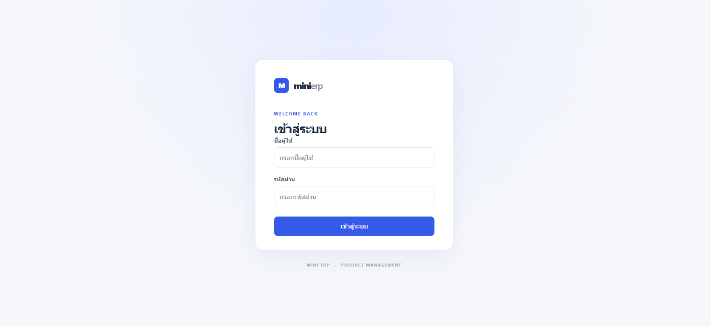

**รายการสินค้า**

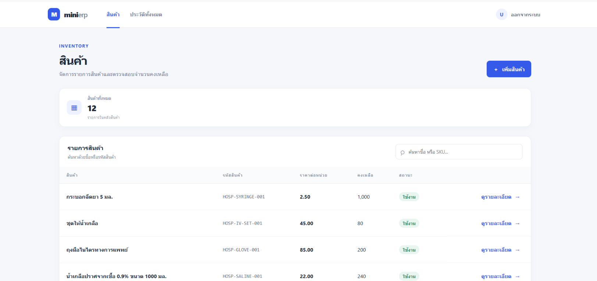

**ประวัติการเปลี่ยนแปลง**

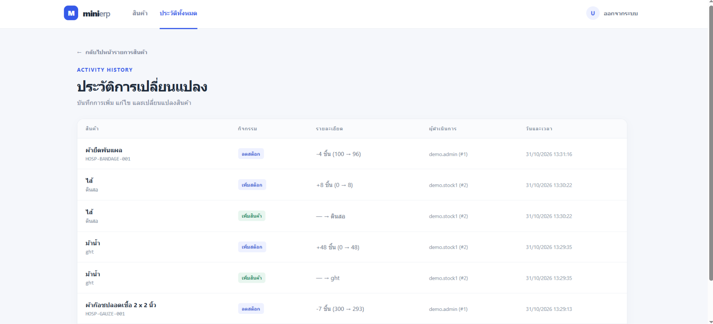

**เพิ่มสินค้า**

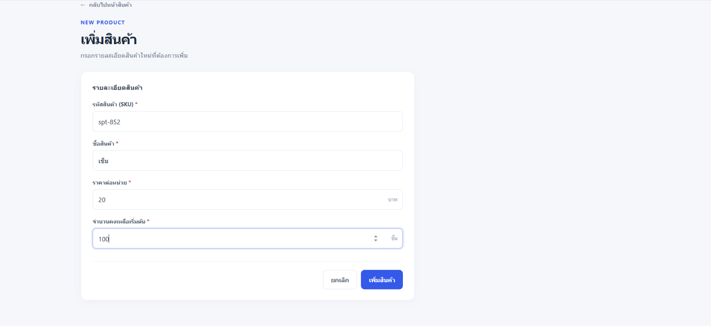

**รายละเอียดสินค้า**

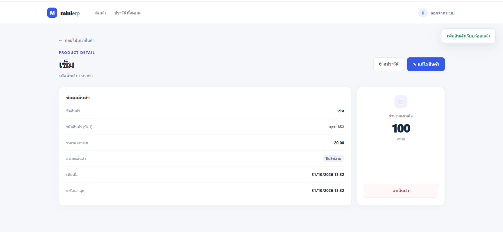

**ยืนยันการลบสินค้า**

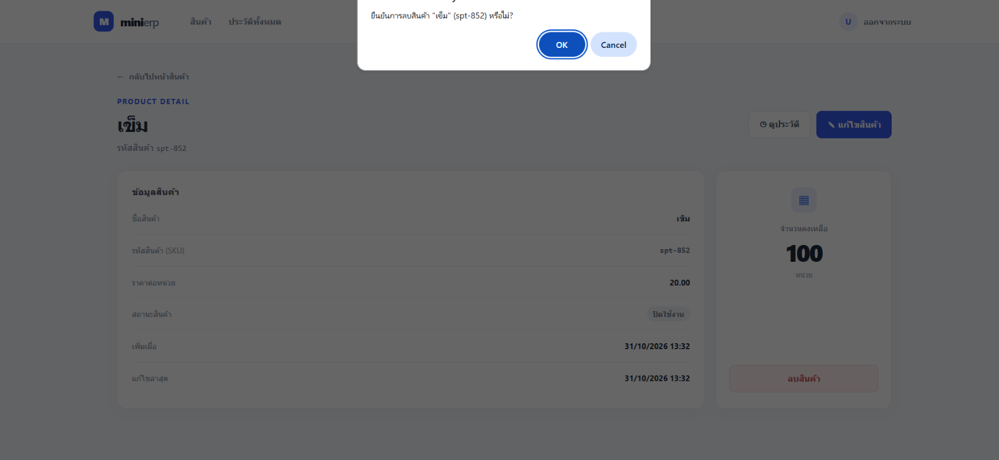

**แก้ไขสินค้า**

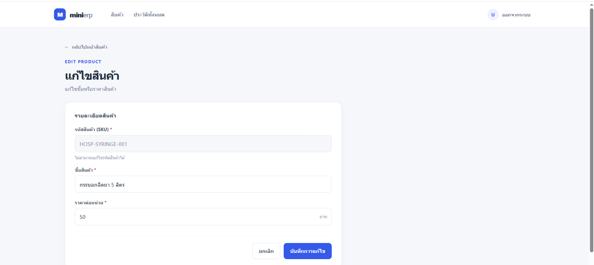

### App (Windows Forms)

**หน้าเข้าสู่ระบบ**

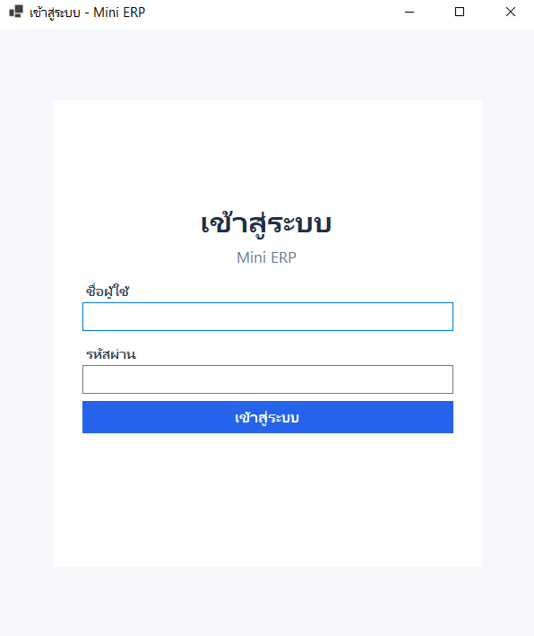

**รายการสินค้าทั้งหมด**

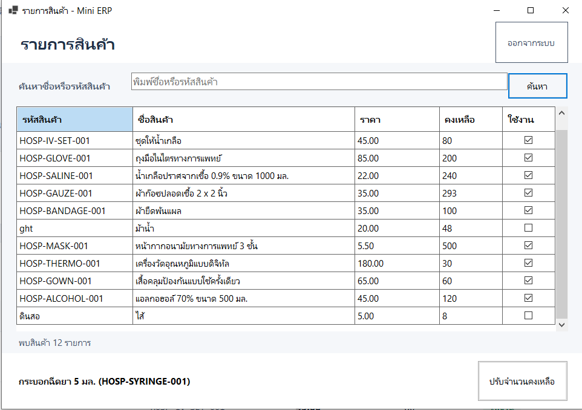

**ค้นหาสินค้า**

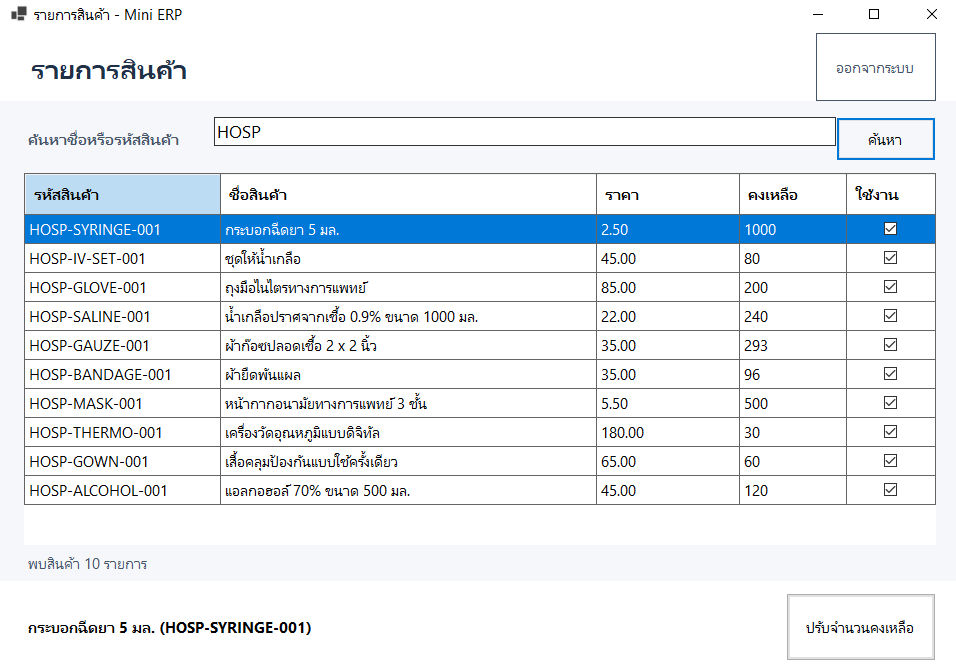

**ปรับจำนวนคงเหลือ**

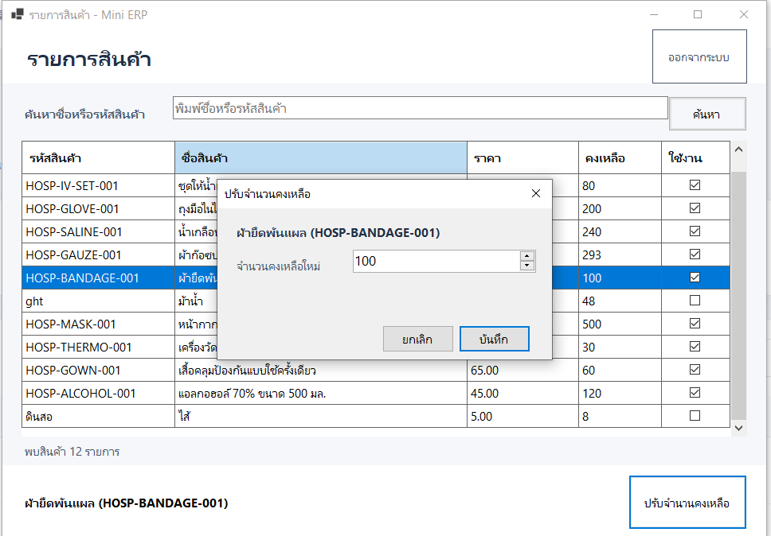
